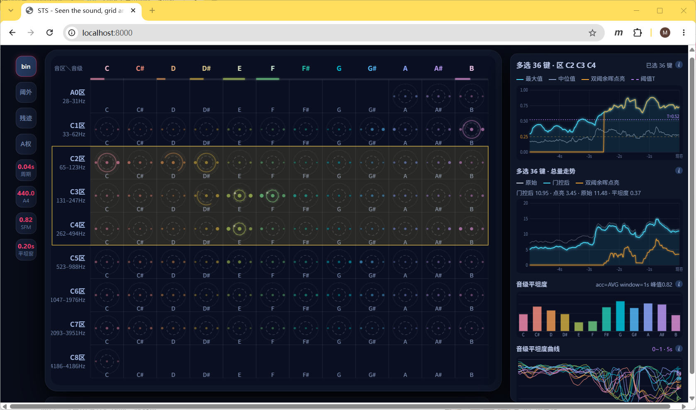

# STS · Seen the Sound（Grid & Charts）

把**声音看见**：麦克风采到的实时频谱，被分拣成 **12 列（十二平均律音级 C…B）× 9 行（按 MIDI 键位平铺的音区）** 的 88 键网格，每格一个迷你极坐标折线盘，配合右侧的走势 / 总量 / 谱平坦度图表，直观呈现"哪一个音、在哪个八度、亮了多久、有多纯"。



## 特性

- **88 键网格盘面**：12 列音级 × 9 行音区（A0–B0 残缺区 + C1–B1 … C7–B7 七个完整八度区 + C8 残缺区），每个钢琴键独立成位，无键的格子不画圈；每格一个迷你极坐标盘，最新 1 圈彩色、上 1 圈渐灰、第 3 圈起不画。
- **CQT 频谱引擎（默认）**：恒定 Q 变换、每八度 36 bin（每半音 3 bin）、对数等距，频率范围对准钢琴 88 键（A0 27.5Hz – C8 4186Hz），解决线性 FFT bin 在低频一个 bin 横跨数个半音的失真问题；`--mode fft` 可随时切回线性 bin 做对照。
- **A 计权响度显示（IEC 61672）**：低频读数随人耳响度下降而非物理电平，页面左栏「A权」按钮或 `--no-aweight` 可实时开关。
- **逐格 onset 门控 + AHDSR 包络**：谱通量自适应阈值判定起音，按格推进 Attack / Hold（按音区时长）/ Decay / Sustain / Release 状态机，让点亮像"琴键余韵"一样自然；参数可通过 HTTP 实时调。
- **实时 SSE 推流**：60fps 字节频谱 + 门控矩阵（base64）经 `/stream` 推给前端，前端零 Web Audio 依赖，纯 Canvas 绘制。
- **交互式侧栏图表**：5 秒幅度走势（原始 / 门控后 / 点亮贡献 + 可拖动阈值 T）、全盘总量走势、十二音级谱平坦度柱状图与走势曲线；点击 / 框选格子、行、列即可切换统计范围。
- **左侧工具列**：`bin` 圆点层、`阈外` 灰线、`残迹`、`A权` 四个开关，以及 周期 / A4 音准 / SFM / 平坦窗 四个滚轮可调瓦片。

## 运行

依赖 Python 3.8+：

```bash
pip install flask numpy sounddevice
```

启动（默认采集麦克风，CQT 模式）：

```bash
python server.py
```

浏览器打开 <http://127.0.0.1:8000/> 即可。

### 常用命令行参数

| 参数 | 说明 |
| --- | --- |
| `--port 8000` | 监听端口 |
| `--device 2` | sounddevice 输入设备索引（麦克风） |
| `--fs 48000` | 采样率 |
| `--tone 440` | 内置恒幅正弦测试音，不经麦克风，彻底排除硬件 / AGC 干扰 |
| `--mode cqt\|fft` | 频谱引擎：`cqt`（默认，对数 bin）/ `fft`（线性 bin 对照） |
| `--fmin 27.5 --fmax 4186 --bpo 36` | CQT 参数：最低 / 最高频率、每八度 bin 数 |
| `--no-aweight` | 关闭 A 计权，显示物理 dB 电平 |
| `--no-gate` | 关闭逐格 onset 门控（保留全部成分） |

麦克风打开失败时会提示改用 `--tone 440` 测试音模式。

## 页面操作

- **点击格子 / 行 / 列**：切换右侧图表的统计范围（单格 → 多选 → 行 / 列 → 全盘）。
- **滚轮**（格子或「周期」瓦片上）：调整环形显示周期（Shift ×10），中键恢复默认。
- **「A4」瓦片**：点击 440 ↔ 432 快切，滚轮细调（Shift ×10、Ctrl ×0.1），中键恢复 440；同时影响前端 bin→音 映射与后端 CQT 栅格。
- **幅度走势图**：上下拖动紫色虚线阈值 T（中键重置），仅对之后的采样生效。
- 连接断开时盘面会铺出遮罩层，点「🔄 重连」恢复。

## HTTP 接口

| 路由 | 说明 |
| --- | --- |
| `GET /` | 返回 `index.html` |
| `GET /dsp-lab` | 返回 `dsp-lab.html`（Sound DSP 实验室页：管道位置 × 变换函数 的图表矩阵，数据源同 `/stream`） |
| `GET /api/tree` | 扫 `content/` 返回目录树 + 全部 `.json` 条目 —— DSP 页左栏文件树与其索引的唯一来源 |
| `GET /api/item?path=content/…json` | 按完整相对路径取单个 DSP 文件条目 |
| `GET/POST/DELETE /api/shots/<name>.png` | 画布快照：GET 取图 / POST 存图（体内 `data:image/png;base64,…`）/ DELETE 删除，落在 `content/Snapshots/` |
| `GET /api/doc` · `POST /api/doc` | 读取 / 整份写回 `content/ViewState/dsp-lab.json`（图表 + 视图状态） |
| `GET /api/templates` · `GET /api/templates/<name>` | 列出 / 读取 `content/Templates/` 下的只读预设 |
| `GET /api/dsps` · `POST /api/dsps[/<name>]` · `DELETE /api/dsps/<name>` | 列出 / 新建 / 写回 / 删除 `content/My dsps/` 下的「我的图」 |
| `POST /api/cmpv` · `DELETE /api/cmpv/<name>` | 新建 / 删除对比视图 `content/Compares/<name>.cmpv`（内容为所选 DSP 的路径列表） |
| `GET /stream` | SSE 频谱推流（60fps）：`s` 字节频谱、`gate` 门控矩阵、`freqs`/`bpo`（CQT）或 `binHz`（FFT）、`fps`/`rfps`/`err` |
| `GET /set_smoothing?v=0.6` | EMA 平滑系数（0~0.95） |
| `GET /set_a4?v=440` | 音准参考 A4（400~480），CQT 栅格与门控映射随之重建 |
| `GET /set_aweight?v=1` | 运行时开关 A 计权 |
| `GET /set_gate_params?...` | 门控参数实时调整：`min_rise_db` / `thresh_mult` / `thresh_floor` / `min_abs_db` / `prev_ema` / `attack` / `decay` / `sustain` / `note_off_db` / `release_tau` / `hold`（逗号分隔 9 个音区秒数）；不带参数返回当前值 |

## 项目结构

```
mySoundZoneGrid/
├── index.html              # 主面板前端：布局、Canvas 绘制、SSE 客户端、侧栏图表
├── dsp-lab.html            # DSP 实验室页（/dsp-lab）：content/ 目录树 + 卡片列表 + 链路视图 + 右栏编辑器
├── server.py               # Flask 后端：麦克风采集 → FFT/CQT → 门控 → SSE + content/ 读写接口
├── content/                # 内容根：DSP 页左栏文件树就是它的目录结构（只列 .json）
│   ├── Templates/          # 出厂预设（只读）
│   ├── My dsps/            # 我的图（可读写，一个 id 一个 .json）
│   ├── Snapshots/          # 画布快照 PNG（暂停时落盘，恢复播放时删除）
│   ├── ViewState/          # dsp-lab.json：DSP 页的图表 + 视图状态
│   ├── Compares/           # 对比视图（.cmpv）：只记要比哪几条 DSP，打开时按卡片列表渲染
│   ├── Favorates/          # 预留分类目录
│   └── Recents/            # 预留分类目录
├── image.png               # README 截图
├── matrix.md               # 「位置 × 函数」的说明笔记
└── README.md
```

## 实现要点 / 注意事项

- **显示"衰减"排查**：本项目最初是为排查"长按琴键时图形幅度衰减"而做的 Python 对照后端——频谱完全不经 Web Audio（麦克风 PCM → numpy → SSE），配合页面上的平滑 / 基线扣除开关即可定位衰减来自音频链路还是"显示超出基线的起伏"这一设计。
- **CQT 性能**：抽取（48k→12k）+ 核长按 2 的幂分桶后整组 ZGEMV，262 个核的点积从 ~9.6ms 降到 ~1ms。
- **最低频窗长**：A0 理想窗长 Q·fs/fmin ≈ 1.9s，超过 1 秒环形缓冲会被截断（A0–G1 有效 Q 下降，相邻半音略有相混），启动日志会给出提示。
- **Windows 定时器**：启动时调用 `timeBeginPeriod(1)` 把 sleep 粒度提到 1ms，保证 60fps 帧间隔（进程退出自动恢复）。
- 后端与前端的音区划分均以 `ZONE_DEFS` / MIDI 键位为准，往首尾插行即可增删音区，超范围区自动留空。
